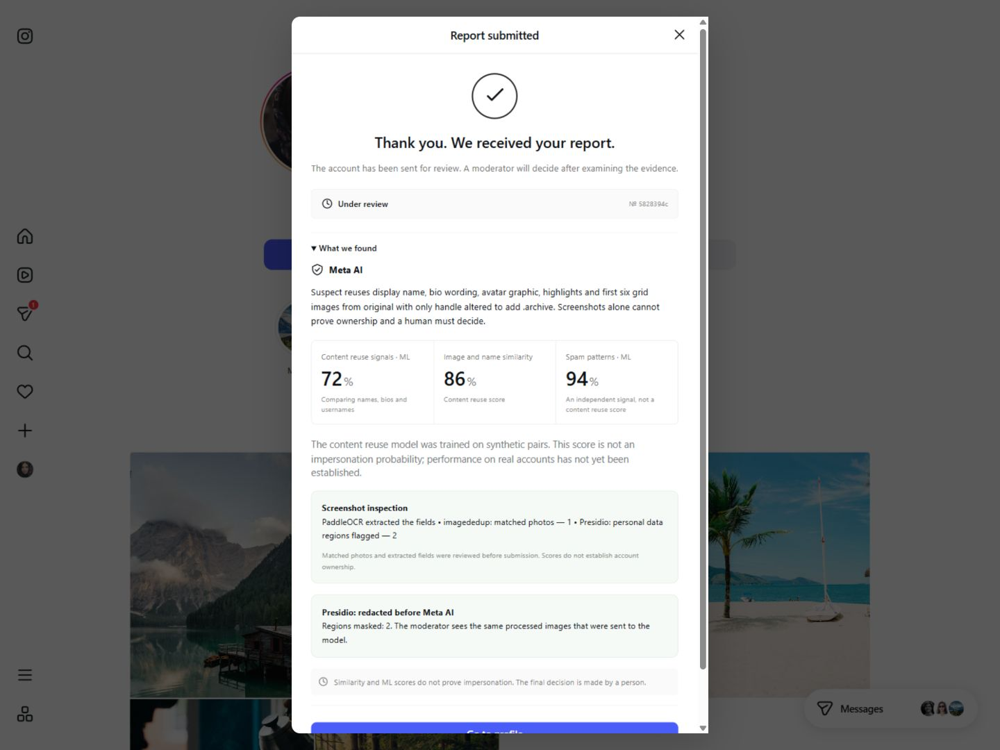

# MirrorCheck — AI-Assisted Impersonation Review

**Meta Muse Spark + local ML + contact redaction + a separate moderator decision.**

[Clean-checkout quick start](QUICKSTART.md) ·
[English project description](submission/PROJECT_DESCRIPTION_EN.md) ·
[Three-minute demo script](submission/DEMO_VIDEO_SCRIPT_EN.md) ·
[Voiceover](submission/VOICEOVER_EN.txt) · [License](LICENSE) · [Attributions](NOTICE.md)

The repository includes the native web application, its archived Flutter client,
tests, two JSON inference models and the English hackathon submission packet.
Use [QUICKSTART.md](QUICKSTART.md) for portable clone/setup instructions. The
Windows launcher installs missing bundled model files without replacing local
training. Runtime secrets, complaints and private reviewer evidence are excluded.



Native React web prototype: **two profile screenshots → editable PaddleOCR fields,
imagededup photo matches and Presidio privacy checks → Meta visual evidence +
independent profile ML and optional pair text-reuse ML → human review → a profile label**. Instagram-style desktop
and phone layouts surround the reporting feature. This is an unofficial concept;
it does not change the real Instagram service.

React 19 + TypeScript + Vite is now the default frontend. FastAPI serves the built
site and API from one origin. Flutter is no longer needed to run or develop it.
Earlier Flutter source remains in `mobile/` as a legacy client.

## Social interface, version 0.9

The local catalogue contains 30 profiles and 20 feed posts. Eight new football fan
communities feature Ronaldo, Messi, Mbappe, Haaland, Bellingham, Salah, Neymar and
Vinicius; eight additional creators cover travel, photography, technology and
lifestyle. Fan handles use `.fan`, are labelled as fan communities, and do not
receive an official verification check. Posts, follower counts and relationships
are demo content, not live Instagram data.

[Embla Carousel 8.6.0](https://github.com/davidjerleke/embla-carousel) adds drag/swipe,
arrow keys, previous/next controls and clickable pagination to post carousels.
[emoji-picker-react 5.1.4](https://github.com/ealush/emoji-picker-react) adds a real
English-search emoji picker to comments and Direct. Picker code and English data
load only when opened, with native emoji and no remote emoji image CDN. Both
projects use the MIT license.

Explore filters topics and searches handles, names and biographies. Follows feed
the Following tab; saved posts and follows persist in this browser. Profiles open
demonstration people lists and retain reporting actions. Direct text/comments and
newly composed posts remain session-local. See [photo credits](http://localhost:8090/photo-credits.html)
for media authors/licenses; `scripts/fetch_football_media.py` regenerates those
attributions and the bundled images. The existing AI/privacy/reviewer contracts
are unchanged.

Version 0.9.1 makes application copy, accessible labels, demo bios/captions,
inspection warnings and moderation screens English. Known historical Russian AI
observations are translated at display time and marked as translations; saved
claims and evidence retain their original bytes. New Meta calls request English
explanations using prompt version `impersonation-evidence-v2-en`, isolating them
from the older language cache. OCR continues to accept multilingual screenshots
and excludes the translated English profile controls from the extracted bio.

## Run this checkout

```powershell
& "C:\Users\admin\Desktop\meta\project\scripts\run_web.ps1" -Rebuild
```

Open [http://localhost:8090/](http://localhost:8090/). The launcher builds `web/`,
starts one hidden local server and writes `outputs/web-api.*.log`. Omit `-Rebuild`
for subsequent launches. It reuses the Python environment and server `.env`, and
does not stop an unrelated service occupying port 8090.

For a fresh checkout, install Python and Node (verified with Node 24.11.1):

```powershell
cd C:\Users\admin\Desktop\meta\project
py -3 -m venv .venv
.\.venv\Scripts\python.exe -m pip install -r requirements.txt
if (!(Test-Path .env)) { Copy-Item .env.example .env }
cd web
npm ci
cd ..
.\scripts\run_web.ps1 -Rebuild
```

For development use two terminals: run
`.\.venv\Scripts\python.exe -m uvicorn src.api:app --host 127.0.0.1 --port 8000`
from the project root and `npm run dev` from `web/`. Stop the production server
first if it occupies 8090. Vite forwards `/api` to port 8000.

## Demo walkthrough

The latest complete English browser run uses fictional `aigerim.k.archive`,
claim `5828394c`: [15-step English walkthrough](http://localhost:8090/english-report-walkthrough.html)
and [persisted warning](http://localhost:8090/profile/aigerim.k.archive).
Actual uncached Meta `muse-spark-1.3` returned English `needs_review` under
`impersonation-evidence-v2-en`; combined similarity was 85.85%, pair text-reuse ML
72.19%, and independent profile spam-pattern ML 94.46%. These scores describe
this fictional input, not general accuracy. The report stayed `under_review`
until the moderator action, then persisted as `confirmed` after reload.

Presidio masked two example contact regions. Preview/provider/stored JPEG hashes
match; a real second local OCR/Presidio pass found zero remaining identifier
regions. imagededup matched one grid region spanning several posts. The reporter
corrected the OCR display name/bio and an omitted original-bio line against the
visible screenshots before submitting. All nine previous claims are unchanged.
Evidence and verification are in `outputs/browser-english-flow-20261104/`.
Rebuild this gallery with `.\.venv\Scripts\python.exe scripts\build_english_flow_walkthrough.py`.

The latest privacy demonstration uses fictional `aigerim.k.safe`, claim
`2ee6228b`: [automatic-redaction walkthrough](http://localhost:8090/redaction-walkthrough.html)
and `outputs/browser-redaction-20261103/verification.json`. Presidio found email
and phone lines; both were permanently covered before the real uncached Meta
request. Preview JPEGs, actual provider JPEG hashes and protected reviewer files
match byte-for-byte. A second real PaddleOCR/Presidio pass found 0 identifiers in
the processed images while imagededup still matched all 6 photos. Meta returned
`needs_review`; this new complaint remains `under_review`. All 8 earlier claims
are unchanged. Rebuild the gallery with
`.\.venv\Scripts\python.exe scripts\build_redaction_walkthrough.py`.

The earlier version-0.7 full browser demonstration uses fictional `aigerim.k.vision`, claim
`d676e40c`: [16-step walkthrough](http://localhost:8090/evidence-tools-walkthrough.html),
[labelled profile](http://localhost:8090/profile/aigerim.k.vision), and
`outputs/browser-evidence-tools-20261103/verification.json`. Actual results:
6 OCR fields per profile, 6 matched post photos, 2 Presidio identifier regions,
9.61 seconds for local inspection, real uncached Meta `needs_review`, combined
similarity 84.8%, pair ML 71.26%, profile ML 94.59%, then human confirmation and
`confirmed` after browser reload. All 7 earlier claims remain unchanged. These
scores describe this input, not general accuracy. Rebuild its evidence gallery with
`.\.venv\Scripts\python.exe scripts\build_evidence_tools_walkthrough.py`.

Uploading both screenshots automatically reads account fields, highlights matching post photos
and checks OCR text for contacts/financial identifiers. Review the editable fields
and processed images before submission. Detected identifier lines are covered
with opaque pixel masks locally; only the processed JPEGs are sent to Meta.
The original screenshots are not sent. No claim is confirmed by these tools.

The earlier full browser demonstration with ML v2 uses fictional `aigerim.k.copy`
and claim `64b51964`: real Meta Muse Spark, pair copy signal 80.46%, standalone
spam-pattern signal 96.46%, then an explicit reviewer confirmation and a profile
label that survives reload. All six previous claims remain unchanged. See the
[12-step browser walkthrough](http://localhost:8090/ml-v2-walkthrough.html) and
`outputs/browser-ml-v2-20261103/verification.json` for screenshots and exact evidence.

1. Search for `aigerim.k.studio` and open its profile.
2. Open its profile or post menu and select the impersonation-report option.
3. Upload original and suspect profile screenshots. Check the explicit account
   facts if you want independent ML scoring. JPEG/PNG/WebP only, at most 5 MB and
   16 megapixels each. For pairwise copy assessment, also check the original
   profile's name and bio. Changing the claimed owner clears stale original text.
4. Submit. In Meta mode the server sends the two redacted images to Meta and validates the
   structured response. The report stays `under_review` until a human acts.
5. Open **Ещё → Проверка жалоб** or `/review`. Sign in with the local server's
   `ADMIN_TOKEN`. Do not share this value or add it to a frontend environment file.
   Review both screenshots and analysis, then confirm or reject.
6. Confirmation adds **Подтверждена имперсонация** to the profile and a warning to
   its demo conversation. Rejection does not create the confirmed label.

On 2026-11-02 this browser flow was verified with a new report `7155d7b3`: real
Meta `muse-spark-1.3`, combined similarity **82.4%**, independent profile ML risk
**94.93%**, followed by human confirmation. Its current status is `confirmed`.
These scores describe this input, not general model accuracy. Older reports were
preserved. Screenshots and the verification record are in `outputs/web-demo/`.

The frontend includes feed, stories, search, profiles, Explore, Reels playback,
saving, likes, comments, a photo composer and conversations. Likes, saves and
follows persist in browser local storage. New posts, comments, profile edits and
messages are session-local demo data. Evidence, analysis and reviewer decisions
use the real backend. This app does not authenticate or publish to Instagram.

## Server configuration

### Local screenshot tools (required for Meta mode)

Install `uv` from its official distribution, then run from the project root:

```powershell
.\scripts\setup_evidence_tools.ps1
.\scripts\run_web.ps1 -Rebuild
```

The setup creates two Python 3.12 environments alongside the main API environment:
`.venv-vision` (PaddleOCR 3.7.0, PaddlePaddle 3.3.1, imagededup 0.3.3.post2,
CPU PyTorch) and `.venv-privacy` (Presidio 2.2.366, spaCy 3.8.18,
`en_core_web_sm` 3.8.0). Separate environments resolve conflicting PyYAML
requirements without weakening either dependency constraint. The exact installed
dependency snapshots are in `requirements-vision.lock.txt` and
`requirements-privacy.lock.txt`; setup uses the pinned top-level requirements and
the explicit official CPU PyTorch index/model wheel URL.

`run_web.ps1` starts hidden loopback workers on 8091 and 8092 when both environments
exist. Initial OCR startup downloads the official mobile detector and Cyrillic
recognizer to the user's PaddleX model cache; later starts reuse them. On this
Windows runtime imagededup/PyTorch must be imported before Paddle to avoid a DLL
load failure. Workers use a random local key in ignored
`outputs/evidence-worker.key`; the key never goes to the browser.

`/api/analysis/status` includes readiness, actual tool versions and
`privacy_redaction_required`. Local comparison still supports manual entry.
Meta submission is blocked when mandatory privacy tools are unavailable.
OCR results expire after 15 minutes, are bound to the exact image pixels and
require field-review acknowledgement. Raw OCR text is not persisted in claim
analysis. The reviewed profile facts feed the existing ML models; their scores,
factors and screenshot-tool summaries are stored with the claim.

Automatic redaction is enforced inside `MetaComparer.analyze`, including callers
without an inspection ticket. Fresh local checks run before an external request or
cache lookup; a failure prevents the request and complaint persistence. Validated
Presidio boxes cover entire OCR lines with padding, using EXIF-aware coordinates.
New canvases strip source metadata. Preview and transport share deterministic
JPEG encoding; `analysis.privacy_redaction` records the policy, region counts and
SHA-256 of the exact provider bytes. New Meta complaints store those same redacted
bytes for reviewers, not the uploaded originals. Existing evidence is unchanged.
Do not interpret this as guaranteed de-identification: the protection covers
detected identifiers, and OCR/recognizers can miss text. Inspect the previews.

Limits: OCR may confuse Latin/Cyrillic letters and miss fields; count abbreviations
are approximate. Photo extraction targets light rectangular profile grids and
compares individual regions with PHash, DHash and pixel correlation. It excludes
circular avatars/highlights, uses one-to-one matches and can miss strong crops or
edits. Matching images do not establish ownership. Presidio checks supported
contacts/financial identifiers in recognized text, not every kind of personal
data; missed OCR can also hide an identifier. These signals supplement human review.

Upstream projects: [PaddleOCR](https://github.com/PaddlePaddle/PaddleOCR)
(Apache-2.0), [imagededup](https://github.com/idealo/imagededup) (Apache-2.0),
[Presidio](https://github.com/data-privacy-stack/presidio) (MIT).

### Provider and reviewer secrets

Keep secrets only in the ignored project `.env`:

- `COMPARER=meta`, `META_API_KEY` and `META_MODEL=muse-spark-1.3` select Meta.
  `MODEL_API_KEY` is also accepted. A fresh checkout needs its own working key.
- Without a key use `COMPARER=local`; local results are labelled explicitly.
  Meta mode without a key returns 503 without silently switching providers.
- `ADMIN_TOKEN` protects reviewer sessions, decisions and evidence images.
  Neither this value nor the Meta key is compiled into the web app.
- `ML_ENABLED=true` enables the profile model when its JSON artifact exists.
  `ML_MODEL_PATH` can override `outputs/ml/profile_risk_model.json`.
- `PAIR_ML_MODEL_PATH` optionally overrides `outputs/ml/pair_risk_model.json`.
  Pair ML requires explicitly supplied text for both profiles, uses no Meta/OCR,
  and is marked as trained on synthetic pairs.

Check readiness without a provider call:

```powershell
.\.venv\Scripts\python.exe scripts\verify_meta.py
```

Optional `--live --activate` sends the built-in images to Meta and records
`outputs/meta-live-check.json`. Restart the backend after configuration changes.
The reporting UI also sends evidence to Meta when Meta mode is selected.

Meta returns structured observations, differences and limitations. It does not
establish ownership or identify people. Combined similarity retains the existing
80% image / 20% handle weighting. Profile ML independently estimates fake/spam-like
patterns from explicit user-provided facts. V2 excludes profile-picture presence.
The separate pair model compares name/bio/handle reuse and explicit fan/parody
disclosures. Its weights are learned on synthetic pairs, its score is not calibrated
for real-world impersonation, and it abstains for empty bios or self-pairs.
No score automatically confirms a claim.

Train the optional model on a fresh machine:

```powershell
.\.venv\Scripts\python.exe -m pip install -r requirements-ml.txt
.\.venv\Scripts\python.exe scripts\train_profile_ml.py --download
.\.venv\Scripts\python.exe scripts\train_pair_ml.py
```

[ML_INTEGRATION.md](ML_INTEGRATION.md) records provenance, holdout errors and limits.
No upstream notebook or pickle is executed.

## API and storage

The production web server mounts these routes under `/api`. Standalone
`src.api:app` exposes them without that prefix.

| Method | Web route | Purpose |
| --- | --- | --- |
| GET | `/api/analysis/status` | Provider, model and ML readiness |
| POST | `/api/evidence/inspect` | Same-origin local OCR, photo matches and privacy preview; no claim/provider call |
| POST | `/api/claims` | Multipart evidence and optional profile facts |
| GET | `/api/claims?handle=...` | Existing report metadata |
| GET | `/api/statuses` | Visible account statuses |
| POST | `/api/reviewer/session` | Same-origin reviewer sign-in |
| GET / DELETE | `/api/reviewer/session` | Session check / sign-out |
| GET | `/api/claims/pending` | Protected queue |
| GET | `/api/claims/{id}/evidence/{original or suspect}` | Protected JPEG |
| POST | `/api/claims/{id}/status?status=...` | Protected human decision |
| POST | `/api/ml/profile-risk` | Independent profile assessment |
| POST | `/api/ml/pair-risk` | Text-reuse signal from explicit original/suspect text |

Reviewer sessions use one-hour HttpOnly, SameSite=Strict cookies. Cookie-authenticated
mutations require a matching Origin. Sessions reset on server restart. Legacy
`X-Admin-Token` remains available to existing local clients. Evidence is normalized
and stored in ignored `outputs/evidence/`; private images are not web assets and
their responses are not cached.

This is a loopback-only hackathon prototype. Legacy report metadata remains public
to local clients; reporter identity is unverified. Public deployment needs real
accounts, per-report access controls, durable sessions, abuse controls and a shared
database. JSON updates, budgets and cache use process-local locks; use one writer
and do not run Gradio as a second writer.

Meta defaults: 30-second timeout, two attempts maximum, 2048 output tokens,
50 provider attempts/hour globally and 10/claimed owner/hour. The short-lived cache
and budgets are process-local. Application logs exclude keys, screenshots and full
responses; token usage is stored with analysis.

## Verification

```powershell
cd C:\Users\admin\Desktop\meta\project
.\.venv\Scripts\python.exe -m pytest -q
.\.venv-vision\Scripts\python.exe -m pytest vision_tests -q
.\.venv-privacy\Scripts\python.exe -m pytest privacy_tests -q
cd web
npm test
npm run build
npx prettier --check src index.html vite.config.ts tsconfig.json package.json
```

The current source has 126 backend tests, 6 real image-tool tests, 3 real Presidio tests
and 24 frontend tests. Automated report tests mock Meta; the browser walkthrough
uses the configured real provider.
On 2026-11-03, all 15 synthetic development scenarios were run through real Meta
`muse-spark-1.3` and local `profile-logreg-v1`: 15/15 expected Meta recommendations,
15/15 valid independent ML outputs and 15/15 pipeline claims left `under_review`.
The real complaints database remained byte-for-byte unchanged. These are development
checks, not independent accuracy measurements on real Instagram accounts.

Open [the interactive evaluation report](http://localhost:8090/evaluation-report.html).
It includes every answer, explicit ML facts and the fictional input images. The
frozen JSON and isolated claims are in `outputs/evals/baseline-20261103/`.
The run used 19,105 input and 8,862 output tokens in successful responses, averaging
4.654 seconds per scenario. The undiscounted estimate for those responses is $0.061545.
No prompt or classifier weights were tuned against these 15 answers.

Two fixture bugs were corrected before the live run: avatar-only and generic-avatar
profiles previously duplicated the entire post grid. The original expected labels
were kept. The runner now records ML even if Meta fails and saves full structured
outputs rather than only recommendation checks. See [EVAL_PLAN.md](EVAL_PLAN.md).

An observed limitation: the generic-avatar candidate scored 71.3% fake/spam risk
despite Meta finding impersonation unlikely; copied-profile candidates scored
13–25%. The classifier targets a different, older dataset and is not calibrated
for impersonation. Do not use its threshold to confirm reports or retrain it on
this small development suite.

Version 0.6.0 addresses that avatar dependency and adds a separate copy-assessment
model. [Open the ML comparison report](http://localhost:8090/ml-improvement-report.html).
On the same input, v2 standalone risk is 6.38% and pair copy signal is 0.62%.
The five copied-profile cases score 87.79–94.15% on pair text reuse. Every one of
the 15 standalone scores is exactly invariant to flipping avatar presence.
These remain development cases, not real-world accuracy measurements. For blank
or blurred screenshots, pair ML uses separately supplied text and cannot override
Meta's insufficient-evidence recommendation.

Pair training: 3,120 synthetic train pairs, 780 validation and 780 holdout pairs,
with disjoint identity families. At the predeclared 0.7 threshold the procedural
holdout has 300/300 detected copies and 0/480 false positives. The shared generator
and 204 repeated feature vectors across train/holdout limit this result; real paired
account evaluation is still needed. The original 15 examples were not used to fit
the model. V2's historical fake/spam holdout accuracy is 88.98% versus v1's 91.53%
(FP 9 versus 6), so it is not presented as a general accuracy improvement.

Candidate models/reports are retained in `outputs/ml/v2/`, old artifacts in
`outputs/ml/v1/`. Reproduce the ML-only integration comparison without Meta calls:

```powershell
.\.venv\Scripts\python.exe scripts\train_profile_ml.py --output-dir outputs\ml\v2
.\.venv\Scripts\python.exe scripts\train_pair_ml.py --output-dir outputs\ml\v2
.\.venv\Scripts\python.exe evals\compare_ml.py --output outputs\evals\new-ml-comparison\results.json
```

The comparison reuses frozen Meta responses and actual screenshot inputs in the
real complaint pipeline, with its own database; it does not generate new live Meta
answers. To reproduce v1 training use `--include-avatar` with a separate output directory.

Reproduce a new live run (requires the configured server key and trained model):

```powershell
.\.venv\Scripts\python.exe evals\run.py
.\.venv\Scripts\python.exe -u evals\run.py --live --limit 15 --run-dir outputs\evals\new-run
.\.venv\Scripts\python.exe evals\report.py outputs\evals\new-run\results.json --output web\public\evaluation-report.html
cd web
npm run build
```

Use a new run directory each time; existing results are not overwritten. Without
`--live` the runner only lists cases and makes no network calls. Each live CLI run
uses the normal provider timeout, retry and process-local budget rules, and its
own complaints/evidence directory. The report generator can compare several result
JSON files by accepting them before `--output`.

Folders: `web/` frontend, `src/` backend, `tests/` regression tests.
[WEB_MIGRATION.md](WEB_MIGRATION.md) is the acceptance contract.
Old Flutter instructions and design are archived in `docs/LEGACY_FLUTTER*.md`.

Version 0.5.1 matches the signed-in instagram.com interface inspected live in Chrome
on 2026-11-02, including the current icon rail, profile layout and Explore search.
A second complete browser demonstration uses report `79b99943` against fictional
`aigerim.k.backup`: real Meta + profile ML, initial pending status, private reviewer
evidence, human confirmation and a label that persists after reload. Its screenshots
and exact scores are recorded in `outputs/browser-walkthrough-20261102/`.
